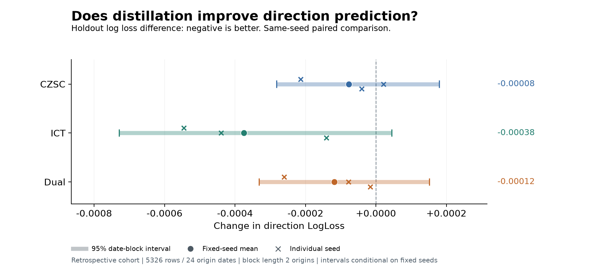
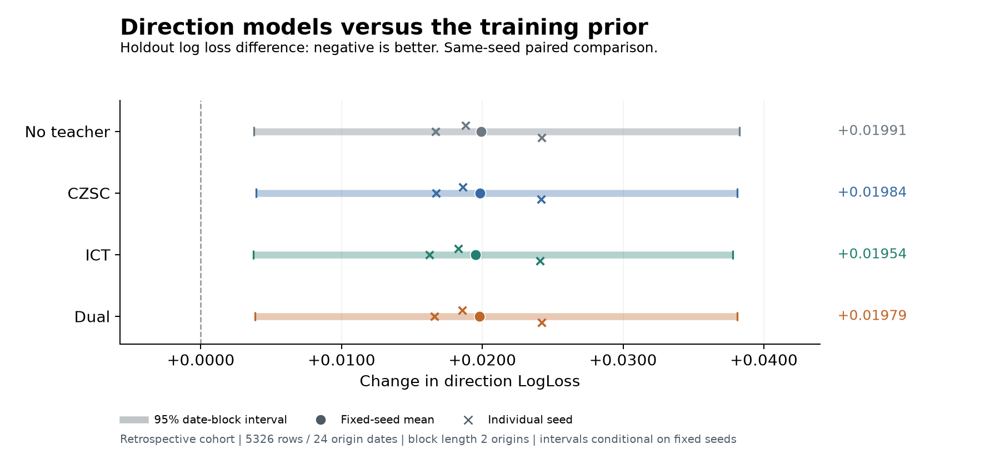

# 240 股消融：事实重建改善，预测收益尚未稳健确认

本页记录 2026-10-21 已完成研究。源码发布包提供汇总结果和图，不提供行情窗口、逐行预测、检查点或带本地路径的来源清单；因此汇总可核对方法与数值，不能替代原始运行证据，也不能保证在不同数据源上逐位复现。

机器可读汇总：[ablation240_summary.json](results/ablation240_summary.json)。操作步骤见[蒸馏指南](distillation_guide.md)。

## 样本和预算

仅使用 2023 年及之前数据，从当年本地观测 4,996 股中的 4,676 股合格池分 36 层选取 240 股，板块配额为沪主板 81、深主板 72、创业板 62、科创板 25。后续缺口不换股。24 股压力样本单独保留，不进入效果比较；80 股机制组是主池嵌套子集。

实际五段 train/tune/calibration/policy/holdout 窗口为 16,611 / 3,649 / 1,633 / 2,510 / 5,326，共 29,729；对应 239 / 231 / 238 / 230 / 237 股。留出有 24 个原点，2026-04-08 至 2026-09-22，标签最晚于 2026-09-30 成熟。更多股票行不是更多独立市场日期。

上下文 128 根、未来 5 根、步长 5；官方 tokenizer 冻结，LoRA rank 4、alpha 8，共同输入 20 项因果上下文统计。四组 × 种子 42/123/2026，每组 8,306 步、batch 4，合计 99,672 次优化器更新；均由共同 tune 方向 LogLoss 选中第 4,154 步。没有根据 holdout 重选检查点。

## 未来方向效果

下表为三个种子均值。Δ 相对同种子无教师；区间是主要 2 原点日期块、2,000 次重采样的描述性 95% 区间。同日股票和固定种子共同重采样。

| 配置 | LogLoss ↓ | Brier ↓ | 准确率 | Δ LogLoss | 主要区间 |
| --- | ---: | ---: | ---: | ---: | --- |
| 无教师 | 0.928067 | 0.584206 | 45.29% | 0 | — |
| CZSC | 0.927989 | 0.584176 | 45.31% | -0.000077 | [-0.000282, +0.000179] |
| ICT | 0.927691 | 0.583942 | 45.44% | -0.000375 | [-0.000729, +0.000045] |
| 双教师 | 0.927948 | 0.584141 | 45.32% | -0.000118 | [-0.000332, +0.000151] |
| 训练 Laplace 频率先验 | 0.908154 | 0.565831 | 49.49% | — | — |

主要区间均跨零。ICT 三个种子点估计均改善；改用 5 原点块时，其 LogLoss 区间约 [-0.000678, -0.000039]，但 Brier 区间仍跨零。结果对块长敏感，不能选择某个区间声称稳健胜出。逆入样概率加权后主要结论相同。

## 教师知识是否学到了

双教师内部头重建历史已知事实，相对 train 常数的误差变化如下，负数更好：

| 教师 | 连续归一化 MAE Δ train 中位数 | 事件 BCE Δ train 频率 |
| --- | ---: | ---: |
| 原生 CZSC | -0.074305 | 无事件头 |
| W32 | -0.112509 | -0.011921 |
| ICT | -0.205702 | -0.033183 |

这支持历史事实重建已有进展。本轮事件也超过频率常数，旧 20 股研究的事件结论不能直接沿用。样本、输入统计与步数同时改变，跨轮改善不能单独归因于扩样。

80 股补充留出评分含 1,813 窗、24 日期、固定种子 42。真实双教师 LogLoss 0.940920591，打乱 train 教师值为 0.940920910，差值约 -0.000000319，主要区间约 [-0.000144, +0.000151]。真实教师重建更好，方向几乎相同，尚不能把未来收益归因于教师语义。

冻结主干、只训练头也能改善连续事实重建；其方向点估计较好但区间宽且选中步数不同，不能证明冻结主干普遍更优。ICT 在 80 股有微小改善信号，但缺少 ICT 专属打乱控制，也没有增加独立市场日期。双教师重复一次得到相同评分，不代表已测得完整 MPS 噪声分布。

## 为什么仍弱于先验

无教师平均预测类别比例 48.61% / 6.95% / 44.44%，真实比例 49.49% / 7.64% / 42.86%，整体比例已经接近。相对训练先验的 LogLoss 差额 +0.019913，三类贡献为 +0.005044 / +0.008278 / +0.006590。

将全留出期平均预测向量作为事后常数，LogLoss 约 0.909136，比逐窗口预测的 0.928067 低约 0.018931，提示窗口概率变化没有提供相应区分力。这是事后算术诊断，平均向量在历史原点不可得，没有据此拟合可部署校准器。

所有组在约一遍训练处取得最佳 tune，后半程回升，继续增加更新数没有持续改善方向。局部梯度诊断显示辅助共享 LoRA 梯度相对共同 AR/方向目标较小；教师确实改变了主干，但参数变化和重建改善不足以推出未来效用。

共同微调改善了相对官方模型的条件 token NLL，教师组没有再超过无教师。该评分使用真实未来前缀，是 teacher forcing 条件似然，不是自由生成价格路径或交易收益。

## 执行与解释边界

本机 M3 Max、36 GiB、MPS 上，正式 12 次训练与评估实测 4 小时 29 分；含公共缓存、80 股前置对照与主报告的 study 为 5 小时 27 分。数据生成和后续补充评分另计。原始预测独立复算与主结果最大差异 1.11e-16。运行结束时 75 项引用文件及冻结代码哈希匹配；源库 stat 未变，不等于完整数据库哈希核验。

这是沿用旧研究日期的回溯分析。本地存量人口有幸存者限制，历史摄取/修订时点未知；26 个未来标签跳空窗口的排除属于事后条件，并未确认公司行动原因或修复价格。只有 24 个留出日期，区间条件于三个固定种子且未校正多重比较。

当前结论是内部历史事实重建改善，稳健预测转移、超过训练先验和双教师互补优势尚未确认。没有校准、交易收益验收、模型晋升或全市场训练。后续应先冻结新协议与时间窗口，再验证 ICT 专属打乱控制、教师梯度预算和目标设计。
